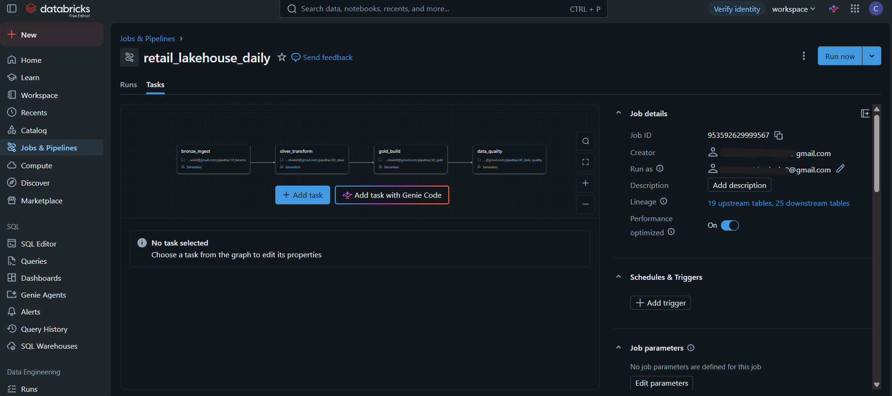
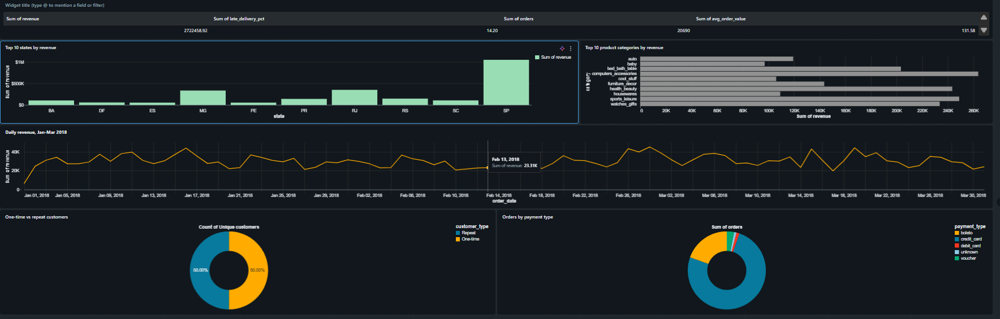

# Retail Lakehouse on Databricks

An incremental **medallion pipeline** (Bronze → Silver → Gold) built with **PySpark and Delta Lake** on **Databricks Free Edition**. It ingests daily retail order files, cleans and upserts them, models them into a star schema, checks data quality, runs as a multi-task Databricks Workflow, and serves a sales dashboard.

**Stack:** Python, PySpark, Delta Lake, SQL, Auto Loader, Unity Catalog, Databricks Workflows, Databricks Dashboards, GitHub

---

## Architecture

```
Source CSVs (Olist dataset)
      │  src/generate_daily_files.py  (simulates a live daily feed)
      ▼
daily/ archive ──► incoming/   (notebooks/98_deliver_files.py drops one month at a time)
      │
      ▼
BRONZE   raw Delta tables, every column kept as a string, + source_file, ingestion_timestamp
      │  Auto Loader + checkpoints: only new files are loaded
      ▼
SILVER   typed, validated, deduplicated tables
      │  MERGE upserts, bad rows go to a quarantine table
      ▼
GOLD     star schema: fact_sales + dim_customer (SCD2), dim_product, dim_seller, dim_date
      │  hash surrogate keys, Unknown member (-1)
      ▼
DATA QUALITY   automated checks → ops.dq_log, critical failure stops the run
      │
      ▼
DASHBOARD   Retail Sales Overview
```

Orchestrated by one Databricks Workflow with four dependent tasks:
`bronze_ingest → silver_transform → gold_build → data_quality`



---

## Data

Source: [Olist Brazilian E-Commerce Public Dataset](https://www.kaggle.com/datasets/olistbr/brazilian-ecommerce) (9 CSV files, 7 used). Not committed to this repo.

The original data is a clean historical archive, so `src/generate_daily_files.py` turns Jan–Mar 2018 into a simulated live feed: **90 daily files for each of 4 tables** (orders, order_items, order_payments, customers), with problems injected on purpose.

| Problem injected | Real-life equivalent | Handled in |
|---|---|---|
| Duplicate rows (~2% per file) | Source system sends a record twice | Silver deduplication |
| Null values (customer_id, price, payment_value) | Lost or missing fields | Silver quarantine table |
| Late-arriving orders (~3%, 1–5 days late) | Delayed upstream delivery | Incremental file ingestion |
| Status updates (~5% of orders) | `processing` later becomes `delivered` | Silver `MERGE` |
| Customer address changes | Repeat customers move | Gold SCD Type 2 |

Products, sellers and the category translation are static reference data, loaded as full overwrites.

---

## How each layer works

**Bronze:** Auto Loader reads new CSV files from `incoming/` and appends them to Delta tables exactly as they arrived. Columns stay as strings so nothing is lost or altered on load (for example, zip codes with leading zeros). A checkpoint per table records which files were processed, so a rerun loads nothing twice.

**Silver:** safe casting (`try_cast`, `try_to_timestamp`) turns bad values into NULL instead of crashing the job. Validation rules give each row a reason code, and rows that fail go to `silver.quarantine` with the reason and the full record as JSON. Valid rows are deduplicated to the latest version per key and merged into silver with Delta `MERGE`. A guard (`file_date >=`) stops an older row from overwriting a newer one.

**Gold:** a star schema at the grain of one row per order item.
- Surrogate keys are hash-based (`xxhash64`), so they stay stable across rebuilds.
- Each dimension has an **Unknown member (-1)**, so unmatched facts stay visible instead of disappearing in a join.
- `dim_customer` is **SCD Type 2** (`valid_from`, `valid_to`, `is_current`), and each fact row points to the customer version that was current when the order was placed.
- Aggregate tables feed the dashboard. Revenue excludes canceled and unavailable orders.

**Data quality:** automated checks in seven groups (reconciliation between layers, uniqueness, completeness, referential integrity, SCD2 rules, business rules, freshness). Results are written to `ops.dq_log`. Failures marked `critical` raise an error, which fails the job run. Pipeline stages are logged in `ops.pipeline_run_log`.

---

## Results

| Check | Result |
|---|---|
| Staged loads (Jan, Feb, Mar) | 7,696 / 7,164 / 7,814 bronze order rows from 31 / 28 / 31 files |
| Bronze / silver orders / gold fact rows | 22,674 / 21,108 / 23,856, identical to a single full load |
| Status updates | Orders still `processing` fell from 107 (after Feb) to 51 (after Mar) as final-status rows arrived and `MERGE` replaced the early rows |
| Rerun with no new files | Counts unchanged, all tasks succeeded |
| Deliberate corruption | A duplicate inserted into silver was caught by the data quality task, which failed the run. The table was repaired with Delta `RESTORE` |

**Dashboard (Jan–Mar 2018):** 20,690 orders, R$2,722,458.92 revenue, R$131.58 average order value, 14.2% of delivered items late.



---

## Design decisions and tradeoffs

- **Strings in bronze, types in silver.** Bronze is a faithful copy of what arrived. One place (silver) decides what is valid, so a NULL can always be traced to the source or to a failed cast.
- **Quarantine instead of deleting.** Bad rows are kept with a reason, so nothing disappears silently and data owners can fix the source.
- **`MERGE` instead of insert.** An order can arrive again with a new status. Merging updates it, and a plain insert would duplicate it.
- **Hash keys instead of `ROW_NUMBER()`.** My earlier SQL Server version used `ROW_NUMBER()` in views, which can change whenever data changes. Hash keys are deterministic.
- **Unknown member.** The earlier version silently produced NULL keys from `LEFT JOIN`. Here they point to a visible -1 row.
- **File delivery instead of a glob filter.** My first staged test used a filename filter on Auto Loader and February never loaded. Delivering files into an `incoming/` folder matches how real sources behave and worked reliably.
- **Fact grain is the order item.** Payments have a different grain (an order can have several), so only the main payment type is kept on the fact. A fuller design would add a separate payments fact.

---

## Limitations and what I would do at scale

- **The data is simulated.** The Olist data is real, but the daily feed and the injected problems are generated by a script.
- **Gold is rebuilt in full on every run.** Bronze and silver are incremental, but at scale I would use incremental `MERGE` for facts and SCD2 dimensions, and partition the fact table by order date.
- **SCD2 history is derived from order-level customer records.** In production this history would come from CDC or merged daily changes.
- **No unit tests or CI yet.** Validation is done through the data quality task and the reconciliation checks.
- **Free Edition constraints:** serverless compute only, daily compute quota, and storage limited to Unity Catalog volumes.
- **Scheduling:** <<state here whether you enabled a schedule or file-arrival trigger, or that Free Edition did not allow it>>.

---

## Repository structure

```
src/         data generator (simulated daily feed)
notebooks/   setup, verification, and dev tools (98_deliver_files, 99_reset_dev)
pipeline/    the four notebooks the workflow runs (bronze, silver, gold, data quality)
workflows/   job definition        <<include only if exported>>
dashboard/   dashboard export      <<include only if exported>>
docs/        screenshots
```

## How to run

1. Create a Databricks Free Edition workspace.
2. Run `notebooks/00_setup.sql` to create the schemas and the `landing` volume.
3. Download the Olist CSVs and upload them to `/Volumes/workspace/bronze/landing/raw_olist/`.
4. Run `src/generate_daily_files.py` in a notebook, then `notebooks/01_verify_daily_files.py`.
5. Create a job with four tasks pointing at the notebooks in `pipeline/`, each depending on the previous one.
6. Run `notebooks/98_deliver_files.py` with `month = 2018-01`, then run the job. Repeat for `2018-02` and `2018-03`.
7. Use `notebooks/99_reset_dev.py` to wipe tables and checkpoints when you want to start over (development only, never schedule it).
